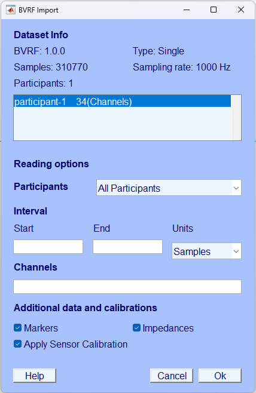

# BrainVision BVRF Reader – MATLAB/EEGLAB Plugin

This plugin lets you import BrainVision Recording Format (BVRF) datasets into MATLAB and EEGLAB. It supports the full BVRF (https://www.brainproducts.com/support-resources/brainvision-recording-format/) file set:

- Header: `*.bvrh` 
- Data: `*.bvrd` 
- Marker: `*.bvrm` 
- Impedance: `*.bvri` 

The plugin reads the header, data, markers and impedances, and creates one EEGLAB `EEG` structure per participant.

## Files and functions provided

The plugin consists of three main functions:

1. **`eegplugin_bvrfimport`**  
   EEGLAB plugin entry point. Adds a menu item to EEGLAB:
   > *File → Import data → From BrainVision (BVRF)...*

2. **`pop_loadbvrf`**  
   EEGLAB “pop_” function with GUI and history support.

3. **`eeg_loadbvrf`**  
   Low-level loader: reads BVRF files and returns EEGLAB `EEG` structs.


## Installation

### EEGLAB
1. Copy the plugin folder into your EEGLAB `plugins` directory:
   ```
   eeglab/plugins/bvrfimport/
   ```
2. Start or restart EEGLAB.
3. You should now see a menu entry:  
   **File → Import data → From BrainVision (BVRF)...**

### MATLAB
  Do not need installation. Use the function eeg_loadbvrf directly.


## 1. Using the EEGLAB GUI

### Menu location

> **File → Import data → From BrainVision (BVRF)...**

This opens the BVRF Reader GUI included with the plugin.

### BVRF Reader GUI

The GUI shows:

- Dataset information (BVRF version, data type, sample count, sampling rate)
- Participant list with channel counts
- Options for:
  - Single or multi-participant import
  - Sample interval import (samples or seconds)
  - Channel index selection
  - Marker and impedance import
  - Apply sensor calibration if coefficients are present.




## 2. Using `pop_loadbvrf` (with GUI or scripting)

### Syntax

```matlab
[ALLEEG, com] = pop_loadbvrf(hdrPath, hdrFileName, 'key', value, ...);
[ALLEEG, com] = pop_loadbvrf;  % launches GUI
```

### Optional parameters

| Parameter | Description |
|----------|-------------|
| `sampleInterval` | `[first last]` sample indices, 1‑based and inclusive (`[1 1000]` = first 1000 samples). Empty = full dataset. See [Indexing and sample intervals](#indexing-and-sample-intervals). |
| `channelIndx` | Vector of channel indices. Empty = all. |
| `flagImportMarkers` | `true`/`false` (default true). |
| `flagImportImpedances` | `true`/`false` (default false). |
| `participantId` | Import only this participant. |
| `usePoly` | `true`/`false` (default: true). Use channels coefficients to calibrate sensor measurements.  |

### Example

```matlab
[ALLEEG, com] = pop_loadbvrf('/data/', 'rec.bvrh', ...
    'sampleInterval', [1 100000], ...
    'channelIndx', 1:32, ...
    'flagImportMarkers', true);
```

## 3. Using `eeg_loadbvrf` directly (low-level loader)

### Syntax

```matlab
[hdr, ALLEEG] = eeg_loadbvrf(hdrPath, hdrFileName, 'key', value, ...);
```

### Example

```matlab
[hdr, ALLEEG] = eeg_loadbvrf('/data/', 'rec.bvrh', ...
    'sampleInterval', [1 600000], ...
    'flagImportMarkers', true, ...
    'verbose', true);
```

## Indexing and sample intervals

BVRF files are **0-based** (the first sample has index 0); MATLAB and EEGLAB are **1-based**. The reader follows one rule:

> Everything you pass in or get back in MATLAB/EEGLAB is **1-based and inclusive**. The conversion to the 0-based BVRF layout happens only when the files are read.

- `sampleInterval = [first last]` reads samples `first` to `last` (both included). `[1 1000]` returns exactly the first 1000 samples; `0` is not a valid index.
- In the GUI, an interval in **seconds** `[t1 t2]` is converted to samples `[round(t1*srate)+1, round(t2*srate)]`, where `t = 0` is the start of the recording. For example, 0–10 s at 500 Hz gives `[1 5000]`.
- The imported segment starts at **time 0 / sample 1** in `EEG.data` (`EEG.xmin = 0`), following EEGLAB conventions for continuous data. Marker latencies are shifted accordingly, and markers outside the segment are dropped.
- The original timeline is preserved:
  - `EEG.etc.bvrf.sampleInterval` – `[first last]` in the original recording (1-based).
  - `EEG.etc.bvrf.fileSampleOffset` – `first - 1`, the 0-based file sample of `EEG.data(:,1)`.
  - `EEG.event(k).bv_sample` – the marker's original 0-based file sample.

  The relation is `EEG.event(k).latency = EEG.event(k).bv_sample - EEG.etc.bvrf.fileSampleOffset + 1`.

## How BVRF fields map to EEGLAB
This section describes how `eeg_loadbvrf` converts a BVRF dataset into the `EEG` structures, one per participant.

### 1. Core Data and Timing

| EEGLAB Field | Source / Meaning |
| ------------ | ---------------- |
| `EEG.data`   | Signal data read from `*.bvrd`. Channels appear in the same order as in the **Channels** section of the header. Data are converted to physical units using `ResolutionPerBit` and, optionally, polynomial coefficients. |
| `EEG.nbchan` | Number of imported channels (rows of `EEG.data`). |
| `EEG.pnts`   | Number of samples (columns of `EEG.data`). |
| `EEG.srate`  | Sampling rate from the header (`SamplingFrequencyInHertz`). |
| `EEG.trials` | Always `1` (continuous data). |
| `EEG.xmin`   | `0`. |
| `EEG.xmax`   | `(EEG.pnts - 1) / EEG.srate`. |
| `EEG.comments` | Contains `Original file: <full path to .bvrh>` to document the source. |

### 2. Participants and Dataset Naming

Participants are inferred from `Channels(k).ParticipantId` as well as the presence of the header field `Participants`:
- If the `Participants` field is present, channels are grouped by participant, resulting in one EEGLAB dataset for each participant ID.  
- If the `Participants` field is absent, the recording is treated as a single-participant dataset with the ID `participant-1`.
- In cases with multiple participants, some sensors may be common to all subjects (for example, a luminance sensor). If `Channels(k).ParticipantId` is not present, it indicates that the sensor is common to all subjects in the dataset. In this situation, the current reader responds by duplicating the channel associated with the sensor in all participants' EEG structures. As a result, the number of channels displayed in the UI comprises the regular channels plus the common sensors.

You can optionally import a specific participant via the `participantId` argument.

| EEGLAB Field             | Source / Meaning |
| ------------------------ | ---------------- |
| `EEG.subject`            | The participant ID (string). |
| `EEG.etc.participant_id` | Same as `EEG.subject`. |
| `EEG.condition`          | If the header contains `Task.Name`, it is used; otherwise empty. |
| `EEG.setname`            | `<TaskName>_<ParticipantId>` if available, otherwise `BVRF_<ParticipantId>`. |

### 3. Channels and Locations (`EEG.chanlocs`)

Channel definitions come from the BVRF **Channels** section.  
Coordinates come from **Electrodes** if provided.

| EEGLAB `chanlocs` Field | Source / Meaning |
| ----------------------- | ---------------- |
| `labels`                | `Channels(k).Name`, or fallback `Ch<k>`. |
| `type`                  | `Channels(k).Type` (e.g., `EEG`, `EOG`, `GSR`, `MISC`). |
| `X`, `Y`, `Z`           | 3D coordinates if the channel’s `Composition.Plus` points to an electrode with defined coordinates. Otherwise left empty. Converted to EEGLAB orientation according to `CoordinateSystems.EEGCoordinateSystem` (see below). |

Supported `EEGCoordinateSystem` values:

| Value     | Orientation in file                         | Conversion to EEGLAB (+X nose, +Y left, +Z up) |
| --------- | ------------------------------------------- | ---------------------------------------------- |
| `Easycap` | RAS (+X right, +Y anterior, +Z superior)    | `X = Y_file`, `Y = -X_file`, `Z = Z_file`      |
| `CapTrak` | RAS (+X right, +Y anterior, +Z superior)    | `X = Y_file`, `Y = -X_file`, `Z = Z_file`      |
| `EEGLAB`  | Already EEGLAB orientation                  | None                                           |

Any other value imports the coordinates unchanged and issues a warning.

To support a new coordinate system, add a row with its name and orientation
code (e.g. `'MySystem', 'LPS'`) to the table in `coordsys_orientation`
(`eeg_loadbvrf.m`). Any three-letter orientation code using each of R/L, A/P
and S/I once is converted to EEGLAB's ALS orientation automatically.

---

### 4. Reference Handling (`EEG.ref`)

The channel’s reference is inferred from the **Minus** part of its `Composition`.  
The plugin summarizes the reference following EEGLAB conventions:

| Condition                                   | Resulting `EEG.ref` |
| ------------------------------------------- | -------------------- |
| No channel has a Minus                      | `'unknown'`          |
| Some have Minus, others don’t               | `'unknown'`          |
| All have Minus but with different Minus     | `'unknown'`          |
| All channels share the same Minus with name | that name (e.g. `Cz`, `REF`) |
| All channels share the same Minus, name empty | `'common'`          |

Full reference definitions from the header are preserved as:

- `EEG.etc.bvrf.references`

### 5. Markers to `EEG.event`

Markers are read from the BVRF `*.bvrm` file and assigned to participants based on their `ParticipantId`.  
Markers without a participant ID or marked “all participants” are assigned to every participant.

#### 5.1 Standard EEGLAB Event Fields

| EEGLAB Field | Source / Meaning |
| ------------ | ---------------- |
| `type`       | Built from BVRF `Type`, `Code`, `Value`: (1) `Type/Code/Value`, (2) `Type/Code`, (3) `Type/Value`, or (4) `Type` alone. If `Type` is missing, a default `"Marker"` label is used. |
| `latency`    | Determined in this order: (1) `Sample` (preferred), (2) `SampleIndex`, (3) `Time` converted to a 0-based sample via `round(Time * srate)`. The 0-based file sample `s0` is then converted to a 1-based latency relative to the first imported sample: `latency = s0 + 1 - (first - 1)`. Markers outside the imported interval are dropped. |
| `comment`    | BVRF `Comment` field or empty if missing. |

The BVRF is a zero-based data format, meaning that the first element of an array has a zero index. This contrasts with MATLAB, which employs one-indexing, where the first sample has an index of one. As a result, when importing BVRF marker latencies into MATLAB/EEGLAB, it is necessary to adjust for this difference in indexing. This adjustment is particularly important when importing the latencies of the markers, which involves adding one (+1) to account for the difference. When only a segment `[first last]` is imported, latencies are additionally shifted so that they are relative to the first imported sample (see [Indexing and sample intervals](#indexing-and-sample-intervals)).

#### 5.2 BVRF-Specific Event Fields

These fields retain the original structure of BVRF markers:

| EEGLAB Event Field | Source |
| ------------------ | ------ |
| `bv_type`          | Original BVRF `Type`. |
| `bv_code`          | BVRF `Code`. |
| `bv_value`         | BVRF `Value`. |
| `bv_sample`        | Original 0-based sample index of the marker in the BVRF file (unchanged by segment import). |
| `bv_StartEndId`    | GUID linking start/end markers of duration events. |
| `bv_channel`       | Channel associated with the marker (empty = all channels). |

This makes it possible to reconstruct durations, filter marker classes, or re-export them.

### 6. Impedances to `EEG.etc.impedances`

If `flagImportImpedances` is `true` and a `*.bvri` file exists:

- The full impedance table is imported.
- Each column becomes a field in a struct.
- Each field contains a cell array of impedance values.

Attached to each dataset as:

- `EEG.etc.impedances`

### 7. Full Header and Metadata (`EEG.etc`)

To maintain provenance and allow reconstruction or debugging, the reader stores the full header:

| EEGLAB Field           | Meaning |
| ---------------------- | ------- |
| `EEG.etc.bvrf_header`  | Full parsed BVRF header (`*.bvrh`). |
| `EEG.etc.participant_id` | Participant ID. |
| `EEG.etc.bvrf.references` | Reference definitions from the header. |
| `EEG.etc.bvrf.sampleInterval` | `[first last]` (1-based, inclusive) position of the imported data in the original recording. |
| `EEG.etc.bvrf.fileSampleOffset` | `first - 1`: 0-based BVRF sample corresponding to `EEG.data(:,1)`. |

You may remove `EEG.etc.bvrf_header` to reduce dataset size after import.

### 8. Sensor Scaling and Polynomials

Raw values (NV) in `*.bvrd` are converted into physical quantities (MQ) using:

- `ResolutionPerBit`  
- Optional rational polynomial coefficients (`Coefficients.Num`, `Coefficients.Denom`)

For each channel:

1. If a polynomial is defined and `usePoly = true`:

   ```text
   MQ = evalRationalPolyAscending(NV, Num, Denom, ResolutionPerBit)

## Known limitations

- Importing fiducials and anatomical coordinates is not supported currently
- Create post processing function to re-evaluate the sensors data given a new set of coefficients.

## License
MIT

